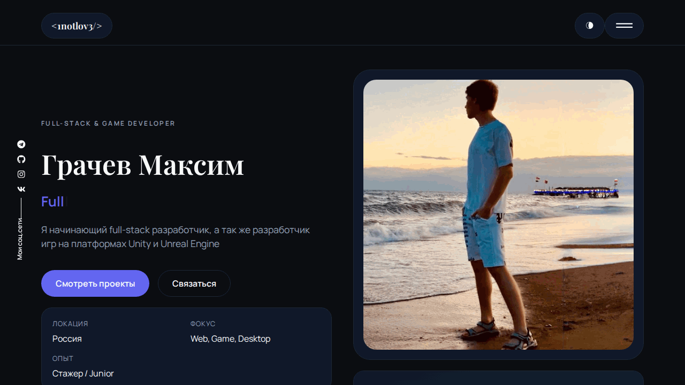

# my-portfolio

Personal frontend portfolio website with project highlights, skills, and contact section.

## Overview

This is a React single-page portfolio app used as a public showcase.

## Demo



Live version: https://1notlov3.github.io/my-portfolio/

## Features

- Intro/hero section
- Skills & project presentation
- Clean responsive layout
- GitHub Pages deployment

## Stack

- React
- JavaScript
- CSS
- react-scripts / Create React App

## Setup

```bash
npm install
npm start
```

App runs on `http://localhost:3000` by default.

## Usage

- Open the app in browser
- Scroll through sections
- Review project cards and links

## Build & Deploy

```bash
npm run build
npm run deploy
```
